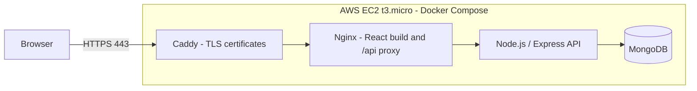
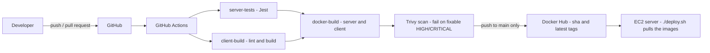

# PulseFit — Containerised Full-Stack App with a Secure CI/CD Pipeline on AWS

[](https://github.com/Abusufiyan01/pulsefit/actions/workflows/ci.yml)
[](https://hub.docker.com/r/abusufiyan70/pulsefit-server)
[](https://hub.docker.com/r/abusufiyan70/pulsefit-client)

PulseFit is a fitness and workout tracker (React, Node.js/Express, MongoDB) that I built as a final-year project.
This repository also shows how I take an application **from `git push` to a running, HTTPS-secured server on AWS**:
containerised with Docker, tested and security-scanned in GitHub Actions, published to Docker Hub, and deployed
on an EC2 server that is created entirely from Terraform code.

> **Live demo:** the demo runs on a small EC2 instance that I switch off between demos to save cost, so the link may be down.
> See the [screenshots](#screenshots). The address is `https://<server-ip-with-dashes>.sslip.io` and changes whenever the server is rebuilt.
> Demo login: `demo@pulsefit.com` / `Demo1234!` (seeded data only).

---

## What this project demonstrates

| Area | What I built |
|------|--------------|
| **Containers** | Multi-stage Dockerfiles, non-root containers, health checks, Docker Compose for the 3-tier stack |
| **CI** | GitHub Actions: Jest tests, client lint + build, Docker image builds on every push and pull request |
| **DevSecOps** | Trivy image scan that fails the pipeline on fixable HIGH/CRITICAL findings, third-party action pinned to a commit SHA, documented and time-limited exceptions |
| **Registry** | Scanned images published to Docker Hub, tagged with the commit ID (and `latest`) so any version can be rolled back |
| **Infrastructure as Code** | Terraform creates the EC2 server, firewall and first-boot setup; the whole environment rebuilds with no manual steps |
| **HTTPS** | Caddy reverse proxy with automatic Let's Encrypt certificates |
| **Process** | Branch ruleset (pull request and passing checks required to merge), least-privilege AWS user, no secrets in the repo |

---

## Architecture

### Runtime



Only Caddy is exposed to the internet (ports 80 and 443). The API and MongoDB have no published ports.

### CI/CD pipeline



---

## Results

| Measure | Result |
|---------|--------|
| API image size | **2.06 GB → 275 MB** (single-stage Debian image → multi-stage Alpine, production dependencies only) |
| Client image size | **75.5 MB** (Nginx serves the static build, no Node runtime) |
| Server image vulnerabilities | 25 HIGH → **0 fixable HIGH/CRITICAL** (pipeline gate passes) |
| Client image vulnerabilities | 68 (65 HIGH, 3 CRITICAL) → **6**, all in Nginx 1.30.6, documented in `.trivyignore` |
| Tests | 5 Jest suites, 29 tests, run on every push and pull request |
| Environment provisioning | About **3 minutes** from `terraform apply` to a running, seeded site |

---

## CI/CD pipeline

Defined in [`.github/workflows/ci.yml`](.github/workflows/ci.yml). It runs on every pull request and on every push to `main`.

| Job | What it does |
|-----|--------------|
| `server-tests` | Installs dependencies and runs the Jest suites (auth, workouts, streaks, photos, nutrition/AI) with throwaway test secrets |
| `client-build` | Runs the linter and builds the React app |
| `docker-build` (server, client) | Builds each image tagged with the commit SHA, prints its size, then **scans it with Trivy** |
| Publish steps | Only on a push to `main`, and only after the scan passes: log in to Docker Hub and push `:<commit-sha>` and `:latest` |

**Security gate.** Trivy fails the job on any fixable HIGH or CRITICAL vulnerability. The few findings that cannot be reached in this
setup are listed in [`.trivyignore`](.trivyignore), each with a written reason and a review date.

**Pinned third-party action.** The Trivy action is pinned to a full commit SHA, not a version tag. In March 2026 the official
Trivy action's version tags were hijacked to run credential-stealing code, and a commit SHA cannot be moved that way. Docker Hub login
uses plain `docker login` instead of adding another third-party action.

**Branch protection.** `main` requires a pull request and passing checks (`server-tests`, `client-build`, `docker-build (server)`,
`docker-build (client)`), and blocks force pushes and branch deletion.

---

## Infrastructure as Code

Everything in [`terraform/`](terraform) creates the server from scratch:

- **Security group:** SSH only from my IP; HTTP and HTTPS open to the world; nothing else.
- **EC2 instance:** Ubuntu 24.04, `t3.micro`, encrypted 20 GB gp3 disk, IMDSv2 required.
- **First-boot script (`user_data.sh`):** adds swap, installs Docker, writes `docker-compose.yml` and the Caddyfile, generates fresh random
  secrets **on the server** (so they never pass through Terraform or Git), starts the stack and seeds the demo data.
- **HTTPS:** the hostname is built from the server's IP using the free `sslip.io` service, and Caddy obtains a Let's Encrypt certificate for it.

The Terraform state file stays on my laptop and is excluded from Git.

---

## Run it locally (Docker Compose)

Requires Docker Desktop.

```bash
git clone https://github.com/Abusufiyan01/pulsefit.git
cd pulsefit
cp .env.example .env
# Put two long random values into JWT_ACCESS_SECRET and JWT_REFRESH_SECRET, e.g. the output of: openssl rand -hex 32
docker compose up -d --build
docker compose exec server node scripts/seed.js
```

Open <http://localhost:8080> and log in with `demo@pulsefit.com` / `Demo1234!`.
`docker compose ps` should show `mongo`, `server` and `client` as healthy.

---

## Deploy to AWS

Requirements: an AWS account, an IAM user with EC2 permissions (not the root user), an EC2 key pair named `pulsefit-key`, and Terraform 1.9 or newer.

```bash
cd terraform
terraform init
terraform plan  -var "my_ip_cidr=$(curl -s https://checkip.amazonaws.com)/32"
terraform apply -var "my_ip_cidr=$(curl -s https://checkip.amazonaws.com)/32"
```

PowerShell: `$myip = (Invoke-RestMethod https://checkip.amazonaws.com).Trim()` and use `"my_ip_cidr=$myip/32"`.

`terraform apply` prints the `site_url` and an `ssh_command`. The site is ready a few minutes after the apply finishes.
To remove everything and stop paying for it: `terraform destroy` with the same `-var`.

### Deploying a version and rolling back

On the server, `./deploy.sh` pulls the images and restarts the stack. Pass a commit SHA to deploy or roll back to an exact version:

```bash
./deploy.sh                # latest
./deploy.sh <commit-sha>   # a specific build, e.g. to roll back
```

---

## Security measures

- Containers run as non-root users; the final server image contains no npm.
- Secrets come from environment variables, never from the repository. The server refuses to run without real JWT secrets in production
  (the old hard-coded fallback was removed).
- The database and API are not published; only the reverse proxy faces the internet.
- Images are scanned on every build and cannot be published if the scan fails.
- AWS access uses a limited IAM user, with no root access keys; SSH is limited to my IP.
- `.dockerignore` files keep `.env`, uploads and local data out of the images.

---

## Lessons learned (what broke and how I fixed it)

1. **Tests passed on my laptop but failed in CI.** The tests relied on a local `.env` for the JWT secret, so CI saw mismatched secrets and
   every authenticated test returned 401. I gave CI explicit throwaway test secrets and removed the hard-coded fallback secret from the code.
2. **A broken workflow file merged with no checks.** An invalid `ci.yml` cannot run, so there was nothing to block the merge. After that
   I added a branch ruleset that requires the checks, and learned that the required check names must match the job names exactly.
3. **Supply-chain risk in the scanner itself.** While adding Trivy I found that its official action had been compromised in March 2026,
   so I pinned it to a commit SHA and used plain `docker login` for the registry.
4. **An outdated base image.** The first client scan found 68 findings, almost all from an Alpine 3.21 base that reached end of support on
   1 November 2026. Moving to a supported base cut it to 6. The remaining 6 are Nginx issues in features this config does not use
   (TLS, HTTP/2, HTTP/3, mail proxy, resolver), documented in `.trivyignore` with a review date of 6 December 2026.
5. **A first-boot script that failed silently.** The EC2 server came up with nothing installed. `cloud-init status --long` and
   `/var/log/cloud-init.log` showed `Exec format error`: a stray blank line before `#!/bin/bash` meant the file was not treated as a script.
   I fixed the file and added `trimspace()` in Terraform so the mistake cannot recur.
6. **HTTPS timed out because port 443 was never opened.** My `terraform plan` had the expected number of changes, but the diff showed
   only an SSH rule moving. The lesson was to read the actual diff, not just the summary line.

---

## Limitations and next steps

- Publishing is automatic, but deploying to the server is one manual command (`./deploy.sh`). Next: automate it using OIDC-based AWS access.
- Terraform state is local. Next: move it to an S3 backend with locking.
- Rebuilding the server recreates the database. A real system would keep data on a persistent volume, a managed database, or backups.
- The `sslip.io` hostname changes with the server's IP. A real domain and an Elastic IP would fix that.
- There is no monitoring yet. Next: CloudWatch alarms managed by Terraform.
- Single instance, single environment, no staging.

---

## The application

PulseFit tracks workouts, nutrition, body metrics and goals, and generates AI plans with a rule-based fallback when no Gemini key is set.

| Layer | Technology |
|-------|-----------|
| Frontend | React 18, Vite, Tailwind CSS, Zustand, React Query, Recharts, Framer Motion |
| Backend | Node.js, Express, Mongoose, JWT auth (httpOnly cookies), Helmet, rate limiting, Multer |
| Database | MongoDB 7 |
| AI | Google Gemini (optional; falls back to rule-based generation) |
| Testing | Jest and Supertest, with an in-memory MongoDB for tests |

The full feature list, API reference, seed data and development guide are in [`docs/APP_GUIDE.md`](docs/APP_GUIDE.md).
The database schema is in [`docs/SCHEMA.md`](docs/SCHEMA.md).

---

## Repository layout

```
pulsefit/
├── .github/workflows/ci.yml   # CI/CD pipeline
├── client/                    # React app + Dockerfile + nginx.conf
├── server/                    # Express API + Dockerfile + Jest tests
├── terraform/                 # EC2, security group and first-boot script
├── docs/                      # App guide, schema, screenshots
├── docker-compose.yml         # Local 3-tier stack
├── .env.example               # Variables for Docker Compose
└── .trivyignore               # Documented, time-limited scan exceptions
```
