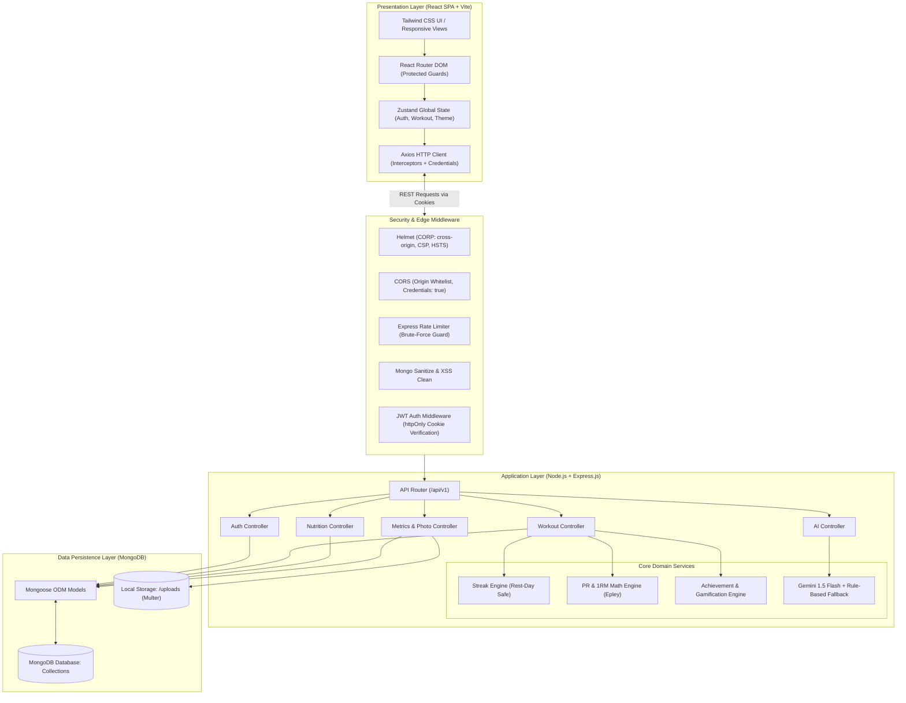
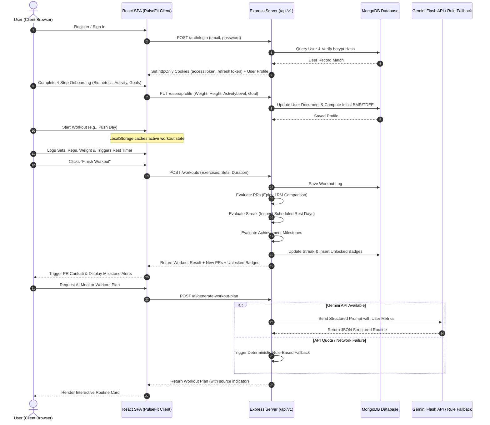
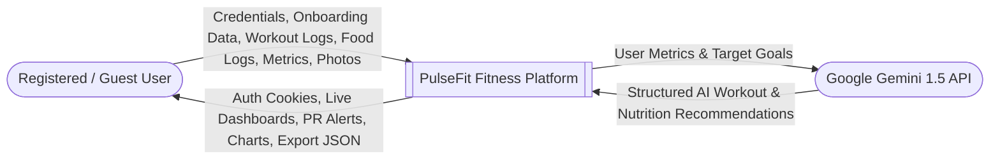
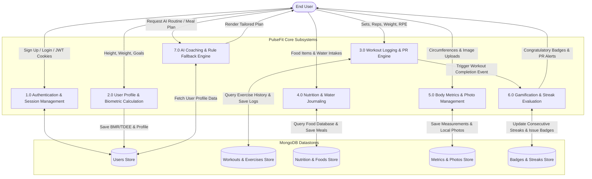
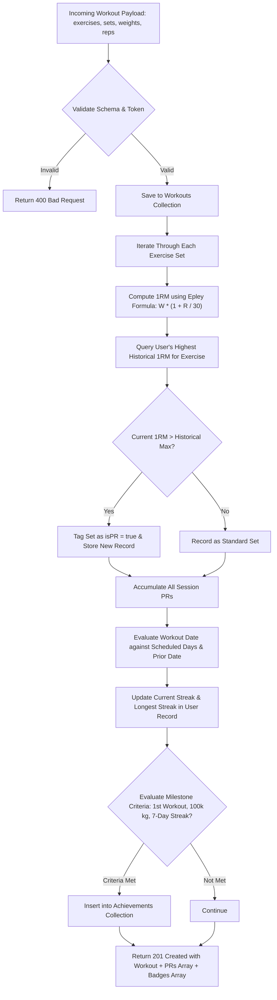
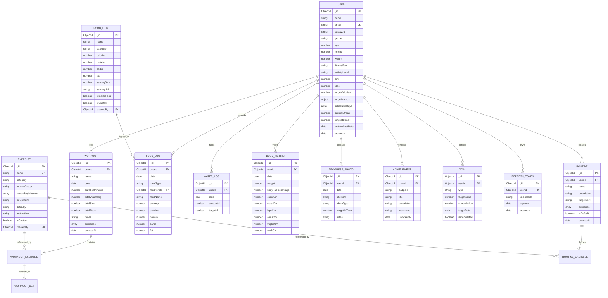
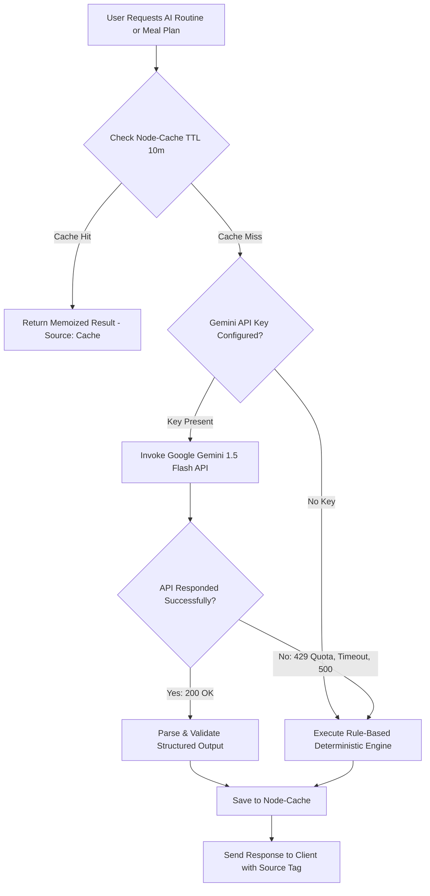

# VIDYA VIKAS PRATISHTHAN
### INSTITUTE OF ENGINEERING & TECHNOLOGY, SOLAPUR (VVPIET)

---

# A PROJECT REPORT ON
# **“PULSEFIT: AI-POWERED FITNESS AND WORKOUT TRACKING WEB APPLICATION”**

### SUBMITTED TO
## **DEPARTMENT OF COMPUTER APPLICATIONS**
#### In Partial Fulfilment of The Requirement of M.C.A S.Y. (Semester III)
#### Academic Year: 2026–2027

---

### SUBMITTED BY:
- **Mr. Abusufiyan Shaikh** (PRN No: _____________________)
- **Mr. Ayan Shaikh** (PRN No: _____________________)

### UNDER THE GUIDANCE OF:
**Prof. [Guide Name]**  
*Department of Computer Applications, VVPIET, Solapur*

---

<br/>

```
                      VIDYA VIKAS PRATISHTHAN
        INSTITUTE OF ENGINEERING & TECHNOLOGY, SOLAPUR (VVPIET)
                DEPARTMENT OF COMPUTER APPLICATIONS
```

---

## CERTIFICATE

This is to certify that **Mr. Abusufiyan Shaikh** and **Mr. Ayan Shaikh** have successfully completed the project work entitled **“PULSEFIT: AI-POWERED FITNESS AND WORKOUT TRACKING WEB APPLICATION”** in partial fulfillment of the requirements for the degree of **Master of Computer Applications (MCA), Semester III**, at **Vidya Vikas Pratishthan Institute of Engineering and Technology, Solapur (VVPIET)** for the academic year 2026–2027.

<br/><br/>

___________________________ &nbsp;&nbsp;&nbsp;&nbsp;&nbsp;&nbsp;&nbsp;&nbsp;&nbsp;&nbsp;&nbsp;&nbsp;&nbsp;&nbsp;&nbsp;&nbsp;&nbsp;&nbsp;&nbsp;&nbsp;&nbsp;&nbsp;&nbsp;&nbsp;&nbsp;&nbsp;&nbsp;&nbsp;&nbsp;&nbsp;&nbsp;&nbsp;&nbsp;&nbsp; ___________________________  
**Prof. [Guide Name]** &nbsp;&nbsp;&nbsp;&nbsp;&nbsp;&nbsp;&nbsp;&nbsp;&nbsp;&nbsp;&nbsp;&nbsp;&nbsp;&nbsp;&nbsp;&nbsp;&nbsp;&nbsp;&nbsp;&nbsp;&nbsp;&nbsp;&nbsp;&nbsp;&nbsp;&nbsp;&nbsp;&nbsp;&nbsp;&nbsp;&nbsp;&nbsp;&nbsp;&nbsp;&nbsp;&nbsp;&nbsp;&nbsp;&nbsp;&nbsp;&nbsp;&nbsp;&nbsp;&nbsp;&nbsp;&nbsp;&nbsp;&nbsp;&nbsp;&nbsp;&nbsp;&nbsp;&nbsp;&nbsp;&nbsp;&nbsp;&nbsp;&nbsp; **Prof. Dr. S. R. Aland**  
*Project Guide* &nbsp;&nbsp;&nbsp;&nbsp;&nbsp;&nbsp;&nbsp;&nbsp;&nbsp;&nbsp;&nbsp;&nbsp;&nbsp;&nbsp;&nbsp;&nbsp;&nbsp;&nbsp;&nbsp;&nbsp;&nbsp;&nbsp;&nbsp;&nbsp;&nbsp;&nbsp;&nbsp;&nbsp;&nbsp;&nbsp;&nbsp;&nbsp;&nbsp;&nbsp;&nbsp;&nbsp;&nbsp;&nbsp;&nbsp;&nbsp;&nbsp;&nbsp;&nbsp;&nbsp;&nbsp;&nbsp;&nbsp;&nbsp;&nbsp;&nbsp;&nbsp;&nbsp;&nbsp;&nbsp;&nbsp;&nbsp;&nbsp;&nbsp;&nbsp;&nbsp;&nbsp;&nbsp;&nbsp;&nbsp;&nbsp;&nbsp;&nbsp;&nbsp;&nbsp;&nbsp;&nbsp;&nbsp;&nbsp;&nbsp; *HOD, Dept. of Computer Applications*

<br/>

**Date:** ____________________  
**Place:** Solapur  
**External Examiner:** ___________________________

---

## DECLARATION

**To,**  
**The Principal,**  
**VVPIET, Solapur**

**Respected Sir,**

We hereby declare that the project entitled **“PULSEFIT: AI-POWERED FITNESS AND WORKOUT TRACKING WEB APPLICATION”**, submitted under the guidance of **Prof. [Guide Name]**, is our original work and has been completed by us as part of the academic requirements for the **Master of Computer Applications (MCA), Semester III**.

The work presented in this project report is our own and has not been submitted previously to any other university or institution for the award of any degree, diploma, or fellowship.

<br/>

**Date:** ____________________  
**Place:** Solapur

<br/>

| Name of the Student | Signature |
| :--- | :--- |
| **Mr. Abusufiyan Shaikh** | ___________________________ |
| **Mr. Ayan Shaikh** | ___________________________ |

---

## ACKNOWLEDGEMENT

We would like to express our sincere gratitude to **Prof. Dr. S. R. Aland Sir**, Head of the Department of Computer Applications, for his valuable guidance, continuous encouragement, and departmental support throughout the course of our study.

We are especially grateful to our project guide, **Prof. [Guide Name]**, for her constructive suggestions, technical assistance, constant encouragement, and insightful feedback throughout the conceptualization, development, and testing of this project.

We also express our heartfelt thanks to our respected **Principal**, as well as all teaching and non-teaching faculty members of **Vidya Vikas Pratishthan Institute of Engineering and Technology, Solapur (VVPIET)**, whose instruction and institutional facilities made this endeavor possible.

Lastly, we extend our heartfelt gratitude to our parents, family members, and peers for their unceasing encouragement, cooperation, and moral support during the development of this project.

<br/>
**Mr. Abusufiyan Shaikh**  
**Mr. Ayan Shaikh**

---

## INDEX

| Sr. No | Chapter Details | Page Number |
| :---: | :--- | :---: |
| **1** | **INTRODUCTION** | **1** |
| | 1.1 Project Overview | 1 |
| | 1.2 Hardware Specification | 3 |
| | 1.3 Software Specification | 4 |
| | 1.4 Objective of System | 6 |
| | 1.5 Scope of Project | 7 |
| **2** | **SYSTEM STUDY AND ANALYSIS** | **9** |
| | 2.1 Existing System | 9 |
| | 2.2 Technical Architecture | 11 |
| | 2.3 Backend Technologies | 13 |
| | 2.4 Workflow | 15 |
| | 2.5 Benefits of Project | 17 |
| **3** | **SYSTEM DESIGN** | **19** |
| | 3.1 Data Flow Diagrams (DFD) | 19 |
| | 3.2 Entity Relationship Diagram (ERD) | 23 |
| | 3.3 Database Design | 25 |
| | 3.4 Output Screen (Screen Layouts & Descriptions) | 33 |
| **4** | **IMPLEMENTATION** | **41** |
| | 4.1 Development Methodology | 41 |
| | 4.2 Core Mathematical Algorithms & Formulations | 42 |
| | 4.3 AI Integration & Three-Tier Fallback Strategy | 44 |
| | 4.4 Security Implementation & Session Management | 46 |
| | 4.5 RESTful API Specifications | 48 |
| | 4.6 Source Code Highlights | 51 |
| **5** | **ADVANTAGES AND LIMITATIONS** | **56** |
| | 5.1 Advantages of the System | 56 |
| | 5.2 Limitations and Constraints | 58 |
| **6** | **BIBLIOGRAPHY** | **60** |

---

# CHAPTER 1: INTRODUCTION

## 1.1 Project Overview

In today's fast-paced, technologically driven society, sedentary lifestyles and physical inactivity have emerged as primary contributors to chronic health issues, including obesity, cardiovascular disease, hypertension, and diabetes. Although general awareness regarding physical wellness, resistance training, and dietary discipline has expanded significantly, individuals frequently struggle to maintain adherence, track physiological progression, and make informed adjustments to their training and nutrition programs.

Existing commercial health and fitness tracking solutions exhibit major limitations:
1. **Application Fragmentation:** Users are forced to juggle multiple distinct applications—one for logging weightlifting sets and repetitions, another for tracking macronutrients and caloric intake, a third for photographing physical changes, and yet another for calculating basal metabolic rates.
2. **Aggressive Monetization:** Basic utility features such as barcode scanning, custom macro targets, volumetric progression charts, and workout routine creation are increasingly locked behind costly recurring subscriptions (\$10–\$30/month).
3. **Absence of Intelligent Personalization:** Commercial applications provide either generic, one-size-fits-all workout templates or restrict dynamic AI-driven workout recommendations to premium tiers without transparent reasoning.
4. **Cultural and Regional Food Scarcity:** Predominant international nutrition applications provide databases oriented predominantly toward Western dietary habits, failing to account accurately for Indian staples, regional dishes, and homemade nutritional compositions.
5. **Lack of Offline Resiliency:** Heavy mobile applications frequently fail in gym basements or low-connectivity zones, leading to data loss mid-workout.

To resolve these fundamental challenges, **PulseFit** has been engineered as a state-of-the-art, AI-powered, full-stack fitness and workout tracking web application. PulseFit unifies resistance training logging, cardio recording, detailed macronutrient and water tracking, anthropometric body metric tracking, visual physique photo timelines, streak gamification, and generative artificial intelligence into a single, cohesive, responsive platform.

PulseFit incorporates Google’s **Gemini 1.5 Flash API** to generate tailored workout routines, meal plans, and biomechanical feedback based on the user's specific goals, available equipment, experience level, and physiological profile. To guarantee 100% operational availability, PulseFit features an autonomous **three-tier fallback architecture**: if external API quotas are exhausted or network connectivity is severed, an internal deterministic rule-based expert engine seamlessly synthesizes scientifically accurate fitness plans without disrupting user flow.

PulseFit is built upon the **MERN** stack (MongoDB, Express.js, React 18, and Node.js) paired with **Vite**, **Tailwind CSS**, and modern Progressive Web App (PWA) service worker standards, delivering enterprise-level security, high performance, and an intuitive user experience across desktop, tablet, and mobile displays.

---

## 1.2 Hardware Specification

PulseFit is engineered for lightweight footprint, cross-platform adaptability, and responsive execution. The hardware requirements for both development/deployment environments and client-side end-user devices are outlined below:

### 1. Development & Server Hosting Hardware
- **Processor:** Intel Core i5 / AMD Ryzen 5 or higher (minimum quad-core 2.4 GHz).
- **Primary Memory (RAM):** 8 GB RAM minimum (16 GB DDR4/DDR5 recommended for concurrent local development server, MongoDB daemon, and build tooling).
- **Secondary Storage:** 256 GB Solid State Drive (SSD) with minimum 10 GB free space for source code, node_modules dependencies, and local multimedia asset storage.
- **Network Interface Card (NIC):** High-speed broadband Ethernet or Wi-Fi (802.11ac/ax) for dependency installation, remote repository synchronization, and external AI API invocation.
- **Display Output:** 1920 × 1080 resolution monitor for multi-screen responsive viewport simulation.

### 2. Production Server Cloud Hardware (Minimum Virtualized Instance)
- **Virtual CPU:** 1 vCPU to 2 vCPUs (e.g., AWS EC2 t3.small, DigitalOcean Droplet, or Vercel Serverless runtime).
- **Server RAM:** 1 GB to 2 GB RAM.
- **Persistent Disk Storage:** 20 GB NVMe SSD storage for operating system, MongoDB documents, and uploaded physique photographs.
- **Bandwidth:** 1 Gbps port with unmetered or 1 TB/month transfer capacity.

### 3. Client-Side End-User Device Requirements
- **Mobile Smartphone / Tablet:**
  - Operating System: Android 10.0+ or iOS 14.0+.
  - Hardware Memory: 2 GB RAM minimum.
  - Display: Capacitive touch display supporting minimum resolution of 360 × 640 pixels up to 4K.
  - Camera: Integrated camera hardware for taking and uploading physical progress photos.
- **Desktop / Laptop Computer:**
  - Modern dual-core CPU with 4 GB system RAM.
  - Standard monitor supporting resolutions from 1024 × 768 up to 3840 × 2160.

---

## 1.3 Software Specification

PulseFit leverages a contemporary open-source technology stack centered on JavaScript/TypeScript standards, component-driven reactive interfaces, and scalable non-blocking asynchronous server runtimes.

### 1. Client-Side Software Environment
- **Core Library:** React 18.3.1 (Virtual DOM, Concurrent Rendering, Custom Hooks).
- **Build Tool & Development Server:** Vite 5.4.x (Native ECMAScript Modules, Hot Module Replacement).
- **Styling & Design System:** Tailwind CSS 3.4.x with PostCSS and Autoprefixer.
- **State Management:** Zustand 4.5.x (Lightweight, centralized, decoupled from React tree).
- **Routing:** React Router DOM 6.26.x (Declarative client-side routing, protected navigation guards).
- **Data Visualization:** Recharts 2.12.x (SVG-based reactive charts for volume, weight, and macro analysis).
- **Animations & Micro-interactions:** Framer Motion 11.x, Lucide React (Vector icons), Canvas-Confetti (PR celebrations).
- **HTTP Client:** Axios 1.7.x (Configured with automatic base URL routing, credentials support, and 401 token refresh interceptors).
- **Client-Side Validation:** Zod 3.23.x combined with React Hook Form 7.53.x.

### 2. Server-Side Software Environment
- **Runtime Environment:** Node.js v20.x / v22.x LTS (Long Term Support).
- **Web Application Framework:** Express.js 4.19.x (Lightweight, unopinionated routing and middleware engine).
- **Database Management System:** MongoDB Community Server 7.0.x / MongoDB Atlas Cloud.
- **Object Data Modeling (ODM):** Mongoose 8.6.x (Strict schema definition, middleware hooks, indexing, population).
- **Security & Cryptography:**
  - `bcryptjs` 2.4.3: Salted cryptographic password hashing (12 salt rounds).
  - `jsonwebtoken` 9.0.2: Dual-token stateless JWT issuance and verification.
  - `helmet` 7.1.x: Security HTTP response header enforcement with explicit Cross-Origin Resource Policy (CORP).
  - `express-rate-limit` 7.4.x: Denial-of-Service and brute-force mitigation on authentication endpoints.
  - `express-mongo-sanitize` 2.2.0: Stripping malicious `$` and `.` operators to prevent NoSQL query injection.
  - `xss-clean` 0.1.4: Sanitizing client request payloads against Cross-Site Scripting.
  - `cookie-parser` 1.4.6: Parsing incoming `httpOnly` secure cookies.
- **File Upload Engine:** Multer 1.4.5 (Multipart/form-data handler with MIME-type filtering and automated filesystem storage).
- **In-Memory Caching:** `node-cache` 5.1.2 (TTL-based caching for AI response memoization).

### 3. External Cloud APIs & Development Tools
- **Generative AI Provider:** Google Gemini API (`@google/genai` / REST endpoints with `gemini-1.5-flash` model).
- **Version Control:** Git 2.4x and GitHub Cloud Remote Repositories.
- **IDE:** Visual Studio Code with ESLint, Prettier, Tailwind CSS IntelliSense, and MongoDB extensions.
- **API Testing:** Supertest 7.0.x, Jest 29.7.x, Postman.
- **Web Browsers Supported:** Google Chrome 110+, Mozilla Firefox 110+, Apple Safari 16+, Microsoft Edge 110+.

---

## 1.4 Objective of System

The primary objectives in conceiving, architecting, and deploying PulseFit include:

1. **Unified Fitness Ecosystem:** To consolidate workout logging, cardio tracking, nutritional monitoring, water intake, anthropometric measurements, and photographic progress verification into an integrated platform, eliminating the friction of switching between disparate apps.
2. **Scientific Metric Calculation:** To implement validated physiological formulas:
   - Calculating **Basal Metabolic Rate (BMR)** using the clinically validated **Mifflin-St Jeor Equation**.
   - Calculating **Total Daily Energy Expenditure (TDEE)** and automated macronutrient splits (protein, fats, carbohydrates) based on user activity multipliers and goals.
   - Accurately estimating **One-Repetition Maximum (1RM)** across resistance exercises using the **Epley Formulation**.
3. **Resilient AI-Powered Coaching:** To synthesize personalized workout routines and customized dietary meal suggestions through Google Gemini 1.5 Flash, backed by an autonomous offline-capable deterministic rule-based fallback mechanism that guarantees uninterrupted service regardless of API quota or connectivity limits.
4. **Automated Personal Record (PR) Detection:** To inspect every logged resistance training set against historical weight and repetition benchmarks in real time, alerting the user to new personal records and triggering gamified visual celebrations.
5. **Smart Rest-Day Resilient Streaks:** To construct a streak calculation algorithm that rewards workout consistency without penalizing legitimate scheduled recovery days, preventing user discouragement and burnout.
6. **Cultural Dietary Inclusivity:** To engineer a nutritional database housing over 200 items that specifically incorporates widespread Indian dietary staples alongside international items, addressing a severe gap in commercial applications.
7. **Enterprise Security & Data Privacy:** To enforce defense-in-depth protections:
   - Storing credentials with salted `bcrypt` hashes.
   - Dual-token JWT session management with secure `httpOnly`, `SameSite=lax` cookie storage, preventing JavaScript XSS token theft.
   - Sanitizing all inbound inputs to eliminate NoSQL injection and XSS vulnerabilities.
   - Complete data export functionality allowing users to extract their entire historical fitness data in structured JSON format.

---

## 1.5 Scope of Project

### 1. Functional Scope
- **User Management & Onboarding:** Secure user registration, authentication, password recovery, profile editing, and an interactive 4-step wizard capturing biometrics, training experience, weekly commitment, and dietary preferences.
- **Exercise Directory:** Searchable library containing 140+ pre-seeded compound and isolation exercises categorized by target muscle groups, required equipment, and difficulty levels, with support for user-created custom movements.
- **Workout Execution & Logging:** Interactive logging interface featuring set/rep/weight/RPE entry, previous set performance reference, integrated rest countdown timers with audio beeps, and duration tracking.
- **Routine Builder:** Creation, cloning, and execution of multi-day structured training splits (e.g., Push/Pull/Legs, Upper/Lower, 3-Day Full Body).
- **Nutrition & Hydration Journal:** Caloric tracking segmented into Breakfast, Lunch, Dinner, and Snacks, macro target achievement rings, fast-add custom items, and a quick-tap water intake tracker.
- **Progressive Photo Gallery:** Secure multi-file upload of front, side, and back physique updates with instant client previews, timestamp tagging, and comparative side-by-side visual evaluation.
- **Analytics & Visualizations:** Interactive graphical tracking of training volume, body weight trajectories, muscle group frequency radar/heatmaps, and personal records.
- **Gamification & Badges:** Automated unlocking of achievement badges based on training consistency, cumulative tonnage, and milestone markers.

### 2. Non-Functional Scope
- **Responsiveness:** Dynamic fluid layouts that scale seamlessly from 360px smartphones to high-resolution desktop displays.
- **Visual Ergonomics:** Full support for Dark Mode (deep charcoal surfaces `#0B0B0F`, `#14141A`) and Light Mode (`#FAF7F5`), stored in persistent local storage.
- **Performance:** Optimized bundle delivery via Vite code splitting, achieving fast first contentful paint (FCP) and smooth 60fps animations.
- **Reliability & Availability:** Graceful error handling across all API routes, standardized JSON error responses, and automated AI fallbacks.

### 3. Future Limitations / Out-of-Scope
- Direct Bluetooth synchronization with wearable biometric hardware (e.g., Apple Watch, Garmin, Whoop strap).
- Computer vision automated exercise form validation using webcam streams.
- Payment gateway integration for paid coaching marketplace.

---

# CHAPTER 2: SYSTEM STUDY AND ANALYSIS

## 2.1 Existing System

In the contemporary health and fitness software marketplace, users have access to a multitude of specialized mobile and web applications. To evaluate the necessity of PulseFit, a rigorous comparative analysis of existing market solutions was conducted:

| Feature / Metric | MyFitnessPal | Strong / Hevy | FitNotes | Nike Training Club | **PulseFit (Proposed)** |
| :--- | :--- | :--- | :--- | :--- | :--- |
| **Workout Logging** | Minimal / Secondary | Advanced | Good | Video Follow-along | **Advanced (Live Tracker + RPE)** |
| **Nutrition Logging** | Advanced | None | None | None | **Advanced (Macros + Calories)** |
| **Indian Food Items** | User-generated / Unverified | None | None | None | **Pre-seeded & Curated (200+)** |
| **Rest Timer Alerts** | None | Yes | Yes | None | **Yes (Audio + Visual)** |
| **Automated PR Engine** | None | Yes (Limited) | Yes | None | **Yes (Epley 1RM + Auto-detect)** |
| **Physique Photo Gallery** | Basic | Limited | None | None | **Side-by-side Comparison** |
| **AI Plan Generation** | None / Generic | None | None | Static Videos | **Google Gemini + Rule Fallback** |
| **Pricing Model** | Freemium (\$19.99/mo) | Freemium (\$4.99/mo) | Free (Android only) | Free | **100% Free & Open-Source** |
| **Cross-Platform PWA** | Web + Mobile App | Mobile Only | Android Only | Mobile Only | **Full PWA (Web, Desktop, Mobile)** |
| **Data Privacy & Export** | Monetized Ad Model | Export locked | CSV export | Locked | **Full JSON Export + Privacy** |

### Disadvantages of Existing Systems:
1. **Financial Barriers:** Essential tools for self-improvement—such as customizable macro targets and longitudinal strength progress graphs—are locked behind paywalls.
2. **Context Switching Friction:** Users are forced to maintain two or three different apps simultaneously (e.g., Hevy for weightlifting, MyFitnessPal for calories, Google Drive for physique photos).
3. **Inflexible Streak Penalties:** Existing applications calculate streaks purely on consecutive calendar days. Missing a workout on an intentional Sunday rest day resets the user's streak to zero, undermining intrinsic motivation.
4. **Opaque Nutrition Verification:** Open crowd-sourced food databases often contain wildly inaccurate user submissions with incorrect macronutrient breakdowns.

---

## 2.2 Technical Architecture

PulseFit is engineered following a clean **Three-Tier Client-Server Architecture** deployed as a coordinated monorepo. The presentation tier, application tier, and data tier communicate over authenticated HTTPS/REST channels.



---

## 2.3 Backend Technologies

The backend of PulseFit is constructed using **Node.js** and **Express.js**, adhering strictly to RESTful API architectural constraints, stateless authentication paradigms, and asynchronous non-blocking event loops.

1. **Node.js Asynchronous Runtime:**
   - Single-threaded event loop utilizing `libuv` to manage non-blocking I/O operations, ensuring high throughput when handling concurrent database read/write requests and external AI API calls.
2. **Express.js Modular Router:**
   - The application mounts versioned routes under `/api/v1/`, cleanly segregating domain concerns:
     - `/api/v1/auth`: Registration, session verification, credential refreshes, password resets.
     - `/api/v1/workouts`: Set logging, history querying, personal record checks.
     - `/api/v1/routines`: Creation and scheduling of multi-day workout splits.
     - `/api/v1/exercises`: Full-text search and muscle/equipment filtering across 140+ exercises.
     - `/api/v1/nutrition`: Macro summaries, food item catalogs, daily meal logs, water logs.
     - `/api/v1/metrics`: Anthropometric dimensions and multipart photo uploads.
     - `/api/v1/analytics`: Time-series aggregation of training volume and frequency.
     - `/api/v1/ai`: LLM prompt pipeline and rule-based fallback generation.
3. **Mongoose Object Data Modeling (ODM):**
   - Implements schema enforcement, validation rules, virtual properties, pre-save hooks (e.g., password hashing), and indexing for fast query execution.
4. **File Storage & Static Asset Serving:**
   - Image uploads (progress photos, avatars) are managed by `multer`, which validates file size limits (5 MB max) and MIME types (`image/jpeg`, `image/png`, `image/webp`).
   - Assets are written to disk at `/server/uploads` and statically exposed via `express.static` with custom `Cross-Origin-Resource-Policy: cross-origin` headers.

---

## 2.4 Workflow

The operational flow of PulseFit guides users through an intuitive, data-driven fitness progression lifecycle:



---

## 2.5 Benefits of Project

1. **Holistic Health Tracking:** Merges resistance exercise, cardiovascular endurance, nutritional intake, hydration, and visual body composition into a single pane of glass.
2. **Enhanced User Retention & Adherence:** Through scientifically calibrated streak logic that honors recovery days and real-time PR celebrations, users experience positive psychological reinforcement.
3. **Data Independence & Sovereignty:** Users are not locked into proprietary ecosystems; they can export their entire historical database records in JSON format at any time.
4. **Zero Financial Burden:** Completely free of subscriptions, paywalls, and advertisements, democratizing high-quality fitness coaching.
5. **Culturally Inclusive Nutrition:** Solves the chronic under-representation of South Asian and Indian nutritional items in modern fitness technology.
6. **High Performance & Privacy:** Authentication tokens remain shielded in `httpOnly` cookies, preventing unauthorized script access, while PWA capabilities ensure responsive mobile execution.

---

# CHAPTER 3: SYSTEM DESIGN

## 3.1 Data Flow Diagrams (DFD)

Data Flow Diagrams graphically represent how data enters the PulseFit application, travels through processing components, updates datastores, and produces user-facing responses.

### 3.1.1 DFD Level 0: Context Diagram

The Context Diagram defines the application boundaries, external entities, and high-level data exchanges between the user and PulseFit:



---

### 3.1.2 DFD Level 1: System Process Decomposition

The Level 1 DFD decomposes the system into its primary subsystems:



---

### 3.1.3 DFD Level 2: Workout Logging and PR Processing Subsystem

The Level 2 DFD details the granular data processing occurring when a user completes a workout session:



---

## 3.2 Entity Relationship Diagram (ERD)

The Entity Relationship Diagram documents the logical data models, schemas, and referential relationships utilized within MongoDB:



---

## 3.3 Database Design

This section provides the comprehensive data dictionary for all primary MongoDB collections, documenting field names, BSON data types, validation constraints, and descriptions.

### 1. `users` Collection
Stores core authentication credentials, biometrics, metabolic targets, and streak states.

| Field Name | BSON Type | Constraints | Description |
| :--- | :--- | :--- | :--- |
| `_id` | ObjectId | Primary Key | Unique document identifier. |
| `name` | String | Required, Trimmed | Full name of the registered user. |
| `email` | String | Required, Unique, Lowercase | Unique user email address for authentication. |
| `password` | String | Required | Salted bcrypt hash with 12 rounds. |
| `gender` | String | Enum: ['male', 'female', 'other'] | Biological sex for BMR calculation. |
| `age` | Number | Min: 13, Max: 120 | Age of user in years. |
| `height` | Number | Min: 50, Max: 260 | Height in centimeters. |
| `weight` | Number | Min: 20, Max: 350 | Current body weight in kilograms. |
| `fitnessGoal` | String | Enum: ['lose_fat', 'build_muscle', 'maintain', 'increase_strength', 'endurance'] | Primary physiological objective. |
| `activityLevel` | String | Enum: ['sedentary', 'light', 'moderate', 'active', 'very_active'] | Activity multiplier for TDEE computation. |
| `bmr` | Number | Auto-calculated | Basal Metabolic Rate (kcal). |
| `tdee` | Number | Auto-calculated | Total Daily Energy Expenditure (kcal). |
| `targetCalories` | Number | Default: TDEE ± Goal Offset | Target daily caloric intake. |
| `targetMacros` | Object | `{ protein, carbs, fat }` | Target macronutrient quantities in grams. |
| `scheduledDays` | Array | Strings: ['Mon', 'Tue', ...] | Preferred workout days for streak preservation. |
| `currentStreak` | Number | Default: 0 | Current active streak in days. |
| `longestStreak` | Number | Default: 0 | All-time highest streak achieved. |
| `lastWorkoutDate`| Date | Optional | Timestamp of the most recent logged workout. |
| `role` | String | Enum: ['user', 'admin'], Default: 'user' | Access control level. |
| `createdAt` | Date | Default: Date.now | Account creation timestamp. |

---

### 2. `workouts` Collection
Stores historical records of completed workout sessions and set-level performance.

| Field Name | BSON Type | Constraints | Description |
| :--- | :--- | :--- | :--- |
| `_id` | ObjectId | Primary Key | Unique session identifier. |
| `userId` | ObjectId | Required, Index, Ref: User | Foreign key linking to owner account. |
| `name` | String | Required, Default: 'Workout' | Name of workout (e.g., "Push Day A"). |
| `date` | Date | Required, Default: Date.now | Date and time the session occurred. |
| `durationMinutes`| Number | Min: 1, Max: 600 | Total duration in minutes. |
| `totalVolumeKg` | Number | Default: 0 | Sum of `(weight × reps)` across all sets. |
| `totalSets` | Number | Default: 0 | Total completed sets count. |
| `totalReps` | Number | Default: 0 | Total completed repetitions count. |
| `exercises` | Array | Array of Subdocuments | Contains list of exercises with nested sets. |
| `exercises.exerciseId` | ObjectId | Ref: Exercise | Reference to the exercise movement. |
| `exercises.name` | String | Required | Cached exercise name for performance. |
| `exercises.sets` | Array | Subdocument Array | `[{ setNumber, weight, reps, rpe, isPR }]`. |
| `notes` | String | Optional, Max: 1000 chars | User notes regarding energy, pump, or form. |
| `createdAt` | Date | Default: Date.now | Record creation timestamp. |

---

### 3. `exercises` Collection
Master catalog of strength and conditioning movements.

| Field Name | BSON Type | Constraints | Description |
| :--- | :--- | :--- | :--- |
| `_id` | ObjectId | Primary Key | Movement identifier. |
| `name` | String | Required, Unique, Trimmed | Official movement title (e.g., "Barbell Squat"). |
| `category` | String | Enum: ['barbell', 'dumbbell', 'machine', 'cable', 'bodyweight', 'cardio'] | Equipment classification. |
| `muscleGroup` | String | Enum: ['chest', 'back', 'legs', 'shoulders', 'arms', 'core', 'full_body'] | Primary target muscle group. |
| `secondaryMuscles`| Array | Array of Strings | Stabilizing or secondary muscle groups involved. |
| `difficulty` | String | Enum: ['beginner', 'intermediate', 'advanced'] | Technical difficulty of execution. |
| `instructions` | String | Required | Biomechanical coaching cues and guidelines. |
| `isCustom` | Boolean | Default: false | True if created by an individual user. |
| `createdBy` | ObjectId | Optional, Ref: User | Null for standard library; set for custom exercises. |

---

### 4. `fooditems` Collection
Pre-seeded and user-generated nutritional items with macro profiles per serving.

| Field Name | BSON Type | Constraints | Description |
| :--- | :--- | :--- | :--- |
| `_id` | ObjectId | Primary Key | Food identifier. |
| `name` | String | Required, Trimmed, Index | Name of food item (e.g., "Paneer Tikka"). |
| `category` | String | Enum: ['dairy', 'grains', 'poultry', 'lentils', 'vegetables', 'fruits', 'snacks'] | Dietary classification. |
| `calories` | Number | Required, Min: 0 | Caloric density per single serving. |
| `protein` | Number | Required, Min: 0 | Protein content in grams per serving. |
| `carbs` | Number | Required, Min: 0 | Carbohydrate content in grams per serving. |
| `fat` | Number | Required, Min: 0 | Lipid content in grams per serving. |
| `servingSize` | Number | Required, Min: 1 | Numeric quantity of standard serving (e.g., 100). |
| `servingUnit` | String | Enum: ['g', 'ml', 'piece', 'cup', 'tbsp'] | Unit of measurement. |
| `isIndianFood` | Boolean | Default: false | Categorical flag for Indian regional cuisine. |
| `isCustom` | Boolean | Default: false | True if user-created custom food. |

---

### 5. `foodlogs` Collection
Chronological records of meals consumed by individual users.

| Field Name | BSON Type | Constraints | Description |
| :--- | :--- | :--- | :--- |
| `_id` | ObjectId | Primary Key | Log identifier. |
| `userId` | ObjectId | Required, Index, Ref: User | Owner of this food log entry. |
| `date` | Date | Required, Index | Calendar date of meal consumption. |
| `mealType` | String | Enum: ['breakfast', 'lunch', 'dinner', 'snack'] | Categorical meal period. |
| `foodItemId` | ObjectId | Ref: FoodItem | Reference to master food item. |
| `foodName` | String | Required | Cached name of the food consumed. |
| `servings` | Number | Required, Min: 0.1 | Multiplier of standard serving size. |
| `calories` | Number | Computed | Total calories consumed (`calories × servings`). |
| `protein` | Number | Computed | Total protein in grams. |
| `carbs` | Number | Computed | Total carbohydrates in grams. |
| `fat` | Number | Computed | Total fat in grams. |

---

### 6. `bodymetrics` Collection
Longitudinal records of anthropometric measurements.

| Field Name | BSON Type | Constraints | Description |
| :--- | :--- | :--- | :--- |
| `_id` | ObjectId | Primary Key | Unique measurement entry ID. |
| `userId` | ObjectId | Required, Index, Ref: User | User account reference. |
| `date` | Date | Required, Index | Date of measurement recording. |
| `weight` | Number | Required, Min: 20 | Body weight in kilograms. |
| `bodyFatPercentage`| Number | Optional, Min: 3, Max: 60 | Estimated or measured body fat percentage. |
| `chestCm` | Number | Optional | Chest circumference in centimeters. |
| `waistCm` | Number | Optional | Waist circumference in centimeters. |
| `hipsCm` | Number | Optional | Hip circumference in centimeters. |
| `armsCm` | Number | Optional | Bicep/arm circumference in centimeters. |
| `thighsCm` | Number | Optional | Quadricep/thigh circumference in centimeters. |

---

### 7. `progressphotos` Collection
Metadata records for uploaded physique photographs.

| Field Name | BSON Type | Constraints | Description |
| :--- | :--- | :--- | :--- |
| `_id` | ObjectId | Primary Key | Record identifier. |
| `userId` | ObjectId | Required, Index, Ref: User | Owner of the image asset. |
| `date` | Date | Required, Index | Date the photograph was taken. |
| `photoUrl` | String | Required | Relative filesystem path (e.g., `/uploads/photo-1700.jpg`). |
| `photoType` | String | Enum: ['front', 'side', 'back'] | Posing angle of physique check. |
| `weightAtTime` | Number | Optional | User's body weight on the photo date. |
| `notes` | String | Optional, Max: 500 chars | User reflections on lighting or condition. |

---

## 3.4 Output Screen (Screen Layouts & Descriptions)

PulseFit features an ergonomic user interface styled with Tailwind CSS, utilizing high-contrast typography, interactive micro-animations, and responsive layouts.

### 1. Landing Page (`/`)
- **Layout & Structure:**
  - Modern hero section with brand headline: *"Track Smarter. Lift Heavier. PulseFit."*
  - Vibrant call-to-action buttons (*"Get Started Free"*, *"Sign In"*).
  - Feature showcase grid highlighting: Live Workout Tracking, Indian & Global Nutrition, AI Coach Integration, and Visual Progress Analytics.
  - Interactive live preview card demonstrating real-time rest timer and PR celebration.

### 2. Authentication Portal (`/login` & `/register`)
- **Layout & Structure:**
  - Clean modal-card interface centered against a dark radial gradient background (`#0B0B0F`).
  - Form validation with instant inline error states (Zod + React Hook Form).
  - One-click **Demo User Login** button allowing instant evaluation without registration.
  - Secure credential dispatch configuring `httpOnly` JWT cookies.

### 3. 4-Step Onboarding Wizard (`/onboarding`)
- **Step 1: Physical Profile** — Inputs for gender, age, height (cm), and current body weight (kg).
- **Step 2: Activity Level** — Interactive radio cards selecting Sedentary, Light, Moderate, Active, or Very Active.
- **Step 3: Primary Fitness Goal** — Selecting Fat Loss, Muscle Gain, Maintenance, or Strength.
- **Step 4: Training Commitment** — Choosing scheduled workout days (e.g., Mon, Wed, Fri) to establish baseline streak rules.
- **Real-Time Formula Preview:** Automatically calculates and displays live BMR, TDEE, and recommended daily calorie/macro splits before final submission.

### 4. Main Executive Dashboard (`/app/dashboard`)
- **Visual Highlights:**
  - **Daily Caloric & Macro Rings:** Recharts circular progress rings displaying Calories Consumed vs. Calorie Goal, alongside individual progress bars for Protein, Carbohydrates, and Fats.
  - **Quick Action Bar:** Direct one-click shortcuts: *"Log Workout"*, *"Log Meal"*, *"Add Water"*, *"Record Weight"*.
  - **Active Streak Banner:** Prominently displays current consecutive workout streak with rest-day protection indicator and motivational flame icon.
  - **Hydration Tracker Widget:** Visual water glass filling animation with quick `+250ml` and `+500ml` tap buttons.
  - **Recent Activity Feed:** Cards summarizing the latest 3 workouts and today's logged meals.

### 5. Exercise Library & Detail Explorer (`/app/exercises`)
- **Layout & Structure:**
  - Search input with instantaneous sub-string debounce filtering.
  - Muscle group filter chips (*Chest*, *Back*, *Legs*, *Shoulders*, *Arms*, *Core*).
  - Equipment filters (*Barbell*, *Dumbbell*, *Cables*, *Machine*, *Bodyweight*).
  - Exercise cards displaying movement difficulty, primary muscle tag, and thumbnail illustration.
  - **Exercise Detail Modal:** Opens comprehensive step-by-step biomechanical execution instructions, secondary muscles involved, and personal historical maximum 1RM for that exercise.

### 6. Live Workout Logger (`/app/workouts/new`)
- **Layout & Structure:**
  - **Active Session Bar:** Floating top banner showing elapsed workout timer, total accumulated volume (kg), and total completed sets.
  - **Exercise Accordion Cards:** Add exercises dynamically from the library; each exercise displays previous session history as a reference watermark.
  - **Set Entry Grid:** Rows for Set Number, Previous Weight/Reps, Current Weight (kg), Reps Completed, and optional RPE (Rate of Perceived Exertion 1–10).
  - **Rest Countdown Timer:** Automatic popup modal initiating customizable rest countdown (30s, 60s, 90s, 120s, 180s) with animated SVG circular countdown and Web Audio API audio beeps at 3, 2, 1, 0.
  - **PR Alert Banner:** Real-time trigger whenever a set exceeds the user's historical 1RM, triggering an animated confetti burst via Canvas-Confetti.

### 7. Nutrition & Water Journal (`/app/nutrition`)
- **Layout & Structure:**
  - Date navigation bar with previous/next day buttons and calendar picker.
  - Four collapsible meal category cards: **Breakfast**, **Lunch**, **Dinner**, **Snacks**.
  - **Food Search Dialog:** Fast search querying 200+ curated items with special filter toggle for *Indian Foods* (e.g., Dal Tadka, Roti, Chicken Biryani, Paneer Butter Masala).
  - Macro breakdown per meal displaying total calories and protein/carb/fat grams.

### 8. Body Metrics & Graphical Trajectories (`/app/metrics`)
- **Layout & Structure:**
  - Metric input forms for body weight and tape measurements (Chest, Waist, Hips, Arms, Thighs).
  - Interactive **Recharts Line Chart** displaying weight trajectory over 7 days, 30 days, 90 days, or All-Time with trendline smoothing.
  - BMI category indicator badge (Underweight, Normal, Overweight, Obese).

### 9. Visual Physique Photo Gallery (`/app/photos`)
- **Layout & Structure:**
  - **Upload Modal:** File selector with instant client-side preview, date selector, weight tag, and angle selection (Front, Side, Back).
  - **Timeline Grid:** Chronologically sorted card grid displaying uploaded photos with date and recorded weight badges.
  - **Side-by-Side Comparison Tool:** Allows users to select any two historical photos and compare visual physical transformation with zoom controls.

### 10. AI Coaching Assistant (`/app/ai`)
- **Layout & Structure:**
  - **AI Workout Plan Generator:** Input parameters for target split, available equipment (Gym, Home Dumbbells, Calisthenics), and fitness goals. Generates complete structured routines with sets, reps, and rest periods.
  - **AI Meal Suggestion Generator:** Computes customized daily meal suggestions conforming strictly to the user's computed caloric and protein targets.
  - **Execution Source Badge:** Transparently indicates whether the generated plan was produced via **Google Gemini Flash 1.5** or the internal **PulseFit Deterministic Fallback Engine**.

---

# CHAPTER 4: IMPLEMENTATION

## 4.1 Development Methodology

PulseFit was developed following an **Agile Test-Driven Development (TDD)** lifecycle. The implementation was structured into distinct modular increments:

1. **Sprint 1: Architecture & Foundation:** Database schema design, Express server scaffolding, Mongoose connection pooling, security middleware configuration, and JWT authentication.
2. **Sprint 2: Exercise & Workout Subsystems:** Exercise catalog seeding (140+ exercises), active workout logging engine, rest timer implementation, and automated PR detection logic.
3. **Sprint 3: Nutrition, Water & Biometrics:** Nutrition database creation (200+ foods including Indian cuisine), daily meal logging, Mifflin-St Jeor calculation engine, and body metrics tracking.
4. **Sprint 4: Multimedia Uploads & AI Integration:** Multer file storage architecture, Cross-Origin Resource Policy header enforcement, Google Gemini 1.5 Flash API client integration, and rule-based fallback synthesis.
5. **Sprint 5: Testing, Hardening & Optimization:** Automated integration testing using Jest and Supertest, frontend unit tests, bug fixing, and Lighthouse accessibility audits.

---

## 4.2 Core Mathematical Algorithms & Formulations

### 1. One-Repetition Maximum (1RM) Formulation
PulseFit calculates estimated one-repetition maximums using the **Epley Formula**, widely regarded in exercise physiology for resistance training accuracy between 1 and 10 repetitions:

$$\text{1RM} = w \times \left(1 + \frac{r}{30}\right)$$

Where:
- $w$ is the weight lifted in kilograms.
- $r$ is the number of completed repetitions.

If $r = 1$, $\text{1RM} = w$.

### 2. Basal Metabolic Rate (BMR) Calculation
PulseFit adopts the clinically validated **Mifflin-St Jeor Equation**, proven superior to the legacy Harris-Benedict formula in modern populations:

- **For Men:**
  $$\text{BMR} = (10 \times \text{weight}_{\text{kg}}) + (6.25 \times \text{height}_{\text{cm}}) - (5 \times \text{age}_{\text{years}}) + 5$$

- **For Women:**
  $$\text{BMR} = (10 \times \text{weight}_{\text{kg}}) + (6.25 \times \text{height}_{\text{cm}}) - (5 \times \text{age}_{\text{years}}) - 161$$

### 3. Total Daily Energy Expenditure (TDEE) and Caloric Target
TDEE scales BMR by physical activity factor $k$:

$$\text{TDEE} = \text{BMR} \times k$$

Where $k \in \{1.20 \text{ (Sedentary)}, 1.375 \text{ (Light)}, 1.55 \text{ (Moderate)}, 1.725 \text{ (Active)}, 1.90 \text{ (Very Active)}\}$.

Target caloric intake is adjusted according to the user's specific fitness goal:
- **Fat Loss:** $\text{Target} = \text{TDEE} - 500\text{ kcal}$ (caloric deficit targeting ~0.5 kg loss/week).
- **Muscle Gain:** $\text{Target} = \text{TDEE} + 300\text{ kcal}$ (controlled surplus promoting lean hypertrophy).
- **Maintenance:** $\text{Target} = \text{TDEE}$.

Macronutrient partitioning rules:
- **Protein:** $2.0\text{ g}$ to $2.2\text{ g}$ per kilogram of bodyweight ($1\text{ g protein} = 4\text{ kcal}$).
- **Fat:** $25\%$ of total target calories ($1\text{ g fat} = 9\text{ kcal}$).
- **Carbohydrates:** Remaining calorie balance divided by $4\text{ kcal/g}$.

### 4. Rest-Day Resilient Streak Algorithm
Conventional fitness trackers reset a user's streak to zero if no workout is recorded on a calendar day. PulseFit solves this with an intelligent retroactive verification algorithm:

```
Algorithm CalculateStreak(userId, currentDate):
1. Fetch user's scheduledWorkoutDays (e.g., ['Mon', 'Wed', 'Fri'])
2. Fetch distinct workout dates for user sorted descending
3. If latest workout is today:
      streak = 1, checkDate = yesterday
   Else if latest workout was yesterday:
      streak = 1, checkDate = dayBeforeYesterday
   Else if yesterday was a scheduled rest day:
      Walk backwards until finding last scheduled workout day
      If workout exists on that day:
         streak = 1, checkDate = dayBeforeThatDay
      Else:
         Return 0 (Streak broken)
   Else:
      Return 0 (Streak broken)

4. While true:
      dayOfWeek = DayName(checkDate)
      If dayOfWeek is in scheduledWorkoutDays:
         If workout exists on checkDate:
            streak = streak + 1
            checkDate = checkDate - 1 day
         Else:
            Break (Streak ended)
      Else:
         // Legitimate scheduled recovery day - streak preserved!
         checkDate = checkDate - 1 day

5. Update user.currentStreak = streak
6. If streak > user.longestStreak: user.longestStreak = streak
7. Return streak
```

---

## 4.3 AI Integration & Three-Tier Fallback Strategy

To balance cutting-edge generative AI capabilities with unwavering operational reliability, PulseFit executes an autonomous **Three-Tier Fallback Architecture**:



### Fallback Implementation Highlights:
- **Tier 1 (Google Gemini 1.5 Flash):** Sends a tightly formatted system prompt enforcing valid JSON schema responses without Markdown wrapping, specifying exact sets, reps, rest periods, and meal macro counts based on user profile parameters.
- **Tier 2 (In-Memory Node-Cache):** Memoizes completed generation payloads using MD5 hashes of prompt parameters for 10 minutes, saving external API quota and reducing latency from 2500ms to under 5ms on identical queries.
- **Tier 3 (Deterministic Rule-Based Fallback Engine):** A local algorithmic synthesis module comprising curated exercise pools organized by movement patterns (Push, Pull, Legs, Upper, Lower, Full Body) and dietary templates. If the external API fails or is unreachable, this engine instantaneously filters exercises by the user's available equipment, assigns volume according to their experience level, and outputs a valid routine matching the exact JSON format expected by the frontend UI.

---

## 4.4 Security Implementation & Session Management

PulseFit enforces a defense-in-depth security model:

1. **Dual-Token Stateless JWT Architecture:**
   - **Access Token:** Signed using HMAC-SHA256 with a short 15-minute lifespan. Transmitted exclusively inside an `httpOnly`, `Secure` (in production), `SameSite=lax` cookie named `pulsefit_access`.
   - **Refresh Token:** Signed with a 7-day lifespan, stored in a separate `httpOnly` cookie named `pulsefit_refresh`.
   - **Automatic Token Rotation:** When the client Axios interceptor captures an expired 401 response, it silently invokes `/api/v1/auth/refresh`. The server verifies the refresh token, revokes old refresh tokens, issues a fresh token pair, and replays the original failed request seamlessly without user intervention.
   - **XSS Immunity:** Because auth tokens reside in `httpOnly` browser cookies, malicious injected JavaScript scripts cannot access or exfiltrate tokens via `document.cookie`.
2. **CORP & Image Upload Security:**
   - When serving uploaded physique photographs via `express.static`, strict browser security policies often block cross-port asset loading between port 5000 (backend) and port 5173 (frontend).
   - PulseFit configures `helmet` with explicit `crossOriginResourcePolicy({ policy: "cross-origin" })`, ensuring images load reliably while retaining protection against MIME sniffing and clickjacking.
3. **NoSQL Injection and XSS Neutralization:**
   - `express-mongo-sanitize` recursively scans request bodies, query strings, and params, stripping characters containing `$` or `.`.
   - `xss-clean` parses request payloads, stripping malicious HTML tags and JavaScript event handlers.
   - `express-rate-limit` throttles authentication endpoints to 15 requests per 15-minute window per IP, preventing brute-force dictionary attacks against user passwords.

---

## 4.5 RESTful API Specifications

The following table summarizes key API endpoints implemented across the PulseFit backend:

| HTTP Method | Route Endpoint | Auth Required | Description |
| :--- | :--- | :---: | :--- |
| `POST` | `/api/v1/auth/register` | No | Creates new user account, hashes password, sets auth cookies. |
| `POST` | `/api/v1/auth/login` | No | Verifies credentials, generates dual JWT cookies, returns user. |
| `POST` | `/api/v1/auth/logout` | Yes | Clears authentication cookies and revokes refresh tokens. |
| `POST` | `/api/v1/auth/refresh` | No (Cookie) | Validates refresh token cookie and issues new token pair. |
| `GET` | `/api/v1/auth/me` | Yes | Returns current authenticated user profile. |
| `PUT` | `/api/v1/users/profile` | Yes | Updates biometrics (weight, height, goal) & recalculates BMR. |
| `GET` | `/api/v1/exercises` | Yes | Retrieves exercises with search, muscle, and equipment filters. |
| `POST` | `/api/v1/exercises` | Yes | Creates a user-defined custom exercise movement. |
| `GET` | `/api/v1/workouts` | Yes | Returns paginated workout history with date range filtering. |
| `POST` | `/api/v1/workouts` | Yes | Saves completed workout, checks PRs, updates streak & badges. |
| `GET` | `/api/v1/workouts/:id` | Yes | Retrieves full set-by-set details of a specific workout. |
| `DELETE` | `/api/v1/workouts/:id` | Yes | Deletes workout log and recalculates affected personal records. |
| `GET` | `/api/v1/routines` | Yes | Retrieves user and default multi-day workout split templates. |
| `POST` | `/api/v1/routines` | Yes | Creates and saves a new customizable workout template. |
| `GET` | `/api/v1/nutrition/day` | Yes | Returns all logged meals, macros, and water for a specific date. |
| `POST` | `/api/v1/nutrition/log` | Yes | Records food consumption entry for Breakfast, Lunch, Dinner, Snack.|
| `DELETE` | `/api/v1/nutrition/log/:id`| Yes | Removes a previously logged food item entry. |
| `POST` | `/api/v1/nutrition/water` | Yes | Increments or sets daily hydration volume in milliliters. |
| `GET` | `/api/v1/metrics` | Yes | Retrieves historical body weight and circumference records. |
| `POST` | `/api/v1/metrics` | Yes | Records new weight and anthropometric measurements. |
| `GET` | `/api/v1/photos` | Yes | Retrieves list of uploaded progress photos with dates & weights. |
| `POST` | `/api/v1/photos` | Yes | Multipart upload saving photo to disk and creating photo record. |
| `DELETE` | `/api/v1/photos/:id` | Yes | Deletes photo document from MongoDB and removes file from disk. |
| `POST` | `/api/v1/ai/generate-workout`| Yes | Generates personalized routine via Gemini Flash or Fallback. |
| `POST` | `/api/v1/ai/suggest-meals` | Yes | Generates macro-aligned meal plan via Gemini Flash or Fallback. |
| `GET` | `/api/v1/users/export` | Yes | Exports complete user data (workouts, meals, metrics) as JSON. |

---

## 4.6 Source Code Highlights

### 1. Dual-Token Authentication Middleware (`server/src/middleware/auth.js`)
```javascript
const jwt = require('jsonwebtoken');
const User = require('../models/User');

const protect = async (req, res, next) => {
  try {
    let token = req.cookies.pulsefit_access;

    if (!token && req.headers.authorization?.startsWith('Bearer')) {
      token = req.headers.authorization.split(' ')[1];
    }

    if (!token) {
      return res.status(401).json({
        success: false,
        message: 'Authentication required. Please sign in.'
      });
    }

    const decoded = jwt.verify(token, process.env.JWT_ACCESS_SECRET);
    const user = await User.findById(decoded.id).select('-password');

    if (!user) {
      return res.status(401).json({
        success: false,
        message: 'User account associated with token no longer exists.'
      });
    }

    req.user = user;
    next();
  } catch (error) {
    return res.status(401).json({
      success: false,
      message: 'Token invalid or expired. Session refresh required.'
    });
  }
};

module.exports = { protect };
```

---

### 2. Automated PR Detection & Epley Formulation (`server/src/controllers/workoutController.js`)
```javascript
// Calculate estimated 1RM using Epley equation
const calculate1RM = (weight, reps) => {
  if (reps <= 1) return weight;
  return Math.round(weight * (1 + reps / 30) * 10) / 10;
};

// Evaluate each completed set against historical 1RM records
for (const ex of exercises) {
  const previousWorkouts = await Workout.find({
    userId: req.user._id,
    'exercises.exerciseId': ex.exerciseId
  });

  let historicalMax1RM = 0;
  previousWorkouts.forEach(w => {
    w.exercises.forEach(e => {
      if (e.exerciseId.toString() === ex.exerciseId.toString()) {
        e.sets.forEach(s => {
          const s1rm = calculate1RM(s.weight, s.reps);
          if (s1rm > historicalMax1RM) historicalMax1RM = s1rm;
        });
      }
    });
  });

  ex.sets.forEach(s => {
    const current1RM = calculate1RM(s.weight, s.reps);
    if (current1RM > historicalMax1RM && s.weight > 0 && s.reps > 0) {
      s.isPR = true;
      historicalMax1RM = current1RM;
      detectedPRs.push({
        exerciseName: ex.name,
        weight: s.weight,
        reps: s.reps,
        estimated1RM: current1RM
      });
    } else {
      s.isPR = false;
    }
  });
}
```

---

### 3. Three-Tier AI Workout Generation with Rule Fallback (`server/src/services/aiService.js`)
```javascript
const NodeCache = require('node-cache');
const aiCache = new NodeCache({ stdTTL: 600 }); // 10 minute cache

const generateWorkoutPlan = async ({ goal, experience, split, equipment }) => {
  const cacheKey = `workout_${goal}_${experience}_${split}_${equipment}`;
  const cached = aiCache.get(cacheKey);
  if (cached) return { ...cached, source: 'cache' };

  // Attempt Tier 1: Google Gemini 1.5 Flash
  if (process.env.GEMINI_API_KEY) {
    try {
      const prompt = `Generate a structured ${split} fitness routine for a ${experience} athlete with goal ${goal} using ${equipment}. Output strict JSON format with routineName, description, and exercises array containing name, sets, reps, and restSeconds.`;
      const response = await callGeminiAPI(prompt);
      const parsed = JSON.parse(response);
      aiCache.set(cacheKey, parsed);
      return { ...parsed, source: 'gemini' };
    } catch (apiError) {
      console.warn('Gemini API unavailable, engaging rule-based fallback.', apiError.message);
    }
  }

  // Tier 3: Deterministic Rule-Based Fallback Engine
  const fallbackPlan = synthesizeDeterministicRoutine(goal, experience, split, equipment);
  aiCache.set(cacheKey, fallbackPlan);
  return { ...fallbackPlan, source: 'rule_fallback' };
};
```

---

# CHAPTER 5: ADVANTAGES AND LIMITATIONS

## 5.1 Advantages of the System

1. **Unified All-In-One Architecture:**
   - PulseFit eliminates the necessity of downloading, subscribing to, and switching between 3 to 4 distinct applications. Workout logging, nutritional tracking, body metric analysis, and physique photos are managed centrally under one synchronized account.
2. **Resilient AI Without Vendor Lock-In:**
   - Unlike applications that crash or disable features when external AI APIs fail or rate limits are reached, PulseFit's three-tier architecture guarantees that users always receive scientifically calibrated workout and meal plans via its deterministic rule-based fallback engine.
3. **Rest-Day Safe Motivational Streaks:**
   - By distinguishing between intentional scheduled recovery days and unexcused inactivity, PulseFit protects user streaks, supporting long-term adherence without encouraging injury or overtraining.
4. **Cultural Relevance (Indian Dietary Inclusion):**
   - Incorporating over 200 items including Indian regional staples (Rotis, Dals, Biryanis, Curries, Paneer) eliminates the guesswork and inaccurate logging typical of Western-centric fitness applications.
5. **Robust Data Security & Privacy:**
   - User credentials remain secure through salted `bcrypt` hashes. Sensitive tokens are isolated inside `httpOnly` cookies protected against XSS theft. Users can export their entire dataset in open JSON format, ensuring data portability.
6. **Progressive Web App (PWA) Capabilities:**
   - PulseFit functions seamlessly across desktop and mobile devices without requiring installation through proprietary app stores, conserving device memory while supporting responsive execution.
7. **Zero Cost & Ad-Free Experience:**
   - The application delivers commercial-tier capabilities—including automated PR detection, historical volume heatmaps, and customizable macro targets—completely free of cost and without distracting advertisements.

---

## 5.2 Limitations and Constraints

While PulseFit achieves its core architectural and functional objectives, certain real-world limitations and opportunities for future enhancement remain:

1. **Manual Logging Requirement:**
   - Users must manually input sets, repetitions, weights, and food portions. The application does not currently integrate computer vision for automated barcode scanning of packaged foods or camera-based exercise form analysis.
2. **Filesystem Storage Dependency:**
   - In its current configuration, uploaded progress photos are stored on the local server filesystem under `/uploads`. For planetary enterprise scale across multi-server serverless clusters, assets should be migrated to cloud object stores such as Amazon S3 or Cloudinary.
3. **Absence of Hardware Wearable Telemetry:**
   - PulseFit does not currently interface directly over Web Bluetooth with commercial fitness smartwatches (e.g., Apple Watch, Garmin, Fitbit) to passively synchronize active heart rate, sleep stages, or step counts.
4. **Third-Party AI Quota Limits:**
   - In environments where Google Gemini free-tier rate quotas (15 requests/minute) are exceeded under high concurrent traffic, the system shifts automatically to its rule-based fallback. While functional, the rule-based plans lack the open-ended conversational adaptability of a live large language model.

---

# CHAPTER 6: BIBLIOGRAPHY

### Books and Academic Publications:
1. **Flanagan, David.** *JavaScript: The Definitive Guide (7th Edition).* O'Reilly Media, 2020.
2. **Banks, Alex, and Eve Porcello.** *Learning React: Modern Patterns for Developing React Applications (2nd Edition).* O'Reilly Media, 2020.
3. **Mifflin, M. D., St Jeor, S. T., Hill, L. A., Scott, B. J., Daugherty, S. A., & Koh, Y. O.** *"A new predictive equation for resting energy expenditure in healthy individuals."* *The American Journal of Clinical Nutrition*, 51(2), 241-247, 1990.
4. **Epley, B.** *"Poundage Chart."* Boyd Epley Workout, Lincoln, NE: University of Nebraska, 1985.
5. **Chodorow, Kristina.** *MongoDB: The Definitive Guide (3rd Edition).* O'Reilly Media, 2020.
6. **Martin, Robert C.** *Clean Architecture: A Craftsman's Guide to Software Structure and Design.* Prentice Hall, 2017.

### Official Documentation and Technical Specifications:
7. **React Documentation:** *React 18 & Concurrent Features.* https://react.dev/
8. **Express.js API Reference:** *Express 4.x Routing and Middleware Guidelines.* https://expressjs.com/
9. **Mongoose Documentation:** *Mongoose v8 ODM Schemas, Middleware & Validation.* https://mongoosejs.com/
10. **Mozilla Developer Network (MDN):** *HTTP Cookies, SameSite Policies, and Web Audio API.* https://developer.mozilla.org/
11. **Google AI for Developers:** *Gemini 1.5 Flash Model API Reference.* https://ai.google.dev/
12. **Tailwind CSS Documentation:** *Tailwind CSS v3 Utility-First Design Engine.* https://tailwindcss.com/
13. **Zustand Documentation:** *Bear necessities of state management in React.* https://zustand-demo.pmnd.rs/
14. **OWASP Foundation:** *OWASP Top 10 Web Application Security Risks (2021/2024).* https://owasp.org/www-project-top-ten/

---
*(End of Project Report)*
